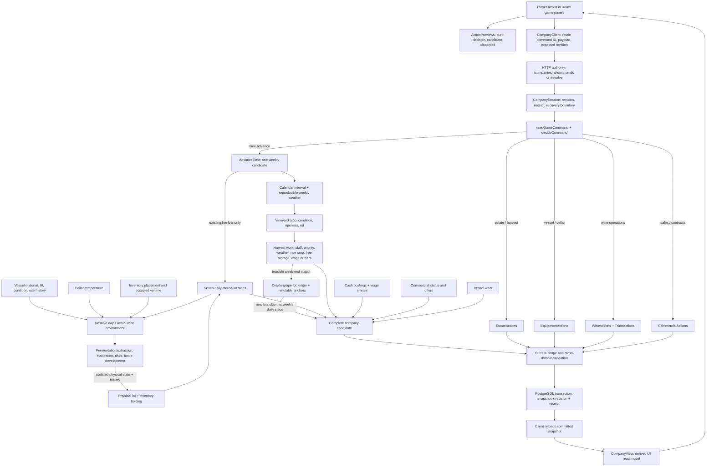
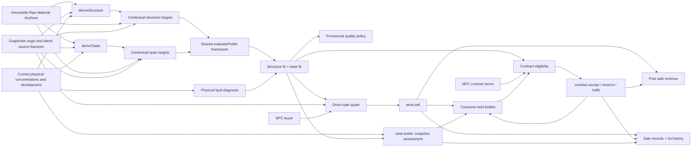

# Variable Relationship Map

This map records verified current 05 owners, inputs, commands, and cross-system dependencies. The [transition overview](Winemaker04_to_05_Transition_Overview.md) describes direction and Winemaker04 evidence, not runtime behavior. Detailed player behavior and the integration-status boundary are in [application flow](application-flow.md). Current numeric coefficients, catalogs, and balance values are provisional implementation choices unless the [design record](design.md) explicitly approves them.

## Command, simulation, and commit flow

## Sensory, assessment, and commercial flow

## Textual relationship index

| Variable or relationship | Owner and state kind | Inputs and transformation | Consumers and changing commands | 05 source |
|---|---|---|---|---|
| Company composition | Core; persisted company snapshot | Calendar, elapsed week, ID sequence, and domain-owned estate, winery, inventory, equipment, finance, work, and commercial sections form one exact current shape. | All commands return a candidate; validation checks shapes and cross-domain invariants before persistence. | [CompanyState.ts](../../src/game/core/CompanyState.ts), [SnapshotValidation.ts](../../src/game/core/SnapshotValidation.ts) |
| Calendar and weekly weather | Calendar and vineyard rules; persisted date and weather | `time.advance` plans the next calendar interval and resolves reproducible weather from date/week context. | Weather drives crop growth/ripening and harvest feasibility; the calendar is shown in the shell. | [Calendar.ts](../../src/game/calendar/Calendar.ts), [AdvanceTime.ts](../../src/game/simulation/AdvanceTime.ts), [vineyard/Rules.ts](../../src/game/vineyard/Rules.ts) |
| Vineyard crop and origin | Vineyard domain; persisted crop state and captured lot origin | Site, grape, area, condition, seasonal progress, and weekly weather determine crop, ripeness, and rot. Terroir Potential uses physical site/grape fit and condition; Origin Prestige is a separate site reputation. Harvest captures vineyard, grape, site, vintage, Terroir Potential, and Origin Prestige. | `vineyard.establish`, `harvest.start`, `harvest.cancel`, `harvest.priority`, and weekly simulation. Origin flows into anchors, sensory target context, and commercial inputs. | [vineyard/Catalog.ts](../../src/game/vineyard/Catalog.ts), [vineyard/Origin.ts](../../src/game/vineyard/Origin.ts), [vineyard/Rules.ts](../../src/game/vineyard/Rules.ts), [EstateActions.ts](../../src/game/commands/EstateActions.ts) |
| Harvest work and output | Work owns staff/activities; vineyard and inventory own crop/storage | Worker capacity is shared evenly among productive assigned activities. Blocked or capped activities release unused time for another fair-share round; priority and stable ID order settle contested crop/storage. Feasible work depends on ripeness, rain, crop, receiving space, and wage arrears. Applied work updates experience. | Partial output is applied at week end and creates a grape lot and a gram holding; the new lot starts daily wine development next week. | [work/Rules.ts](../../src/game/work/Rules.ts), [AdvanceTime.ts](../../src/game/simulation/AdvanceTime.ts) |
| Inherited anchors and physical lot | Wine domain; immutable anchors/origin plus mutable process/development/history state | Harvest maps vineyard conditions into sugar, acidity, phenolic, aroma, body, and aging-potential baselines. Pressing and later operations transform physical state while preserving source identity and lineage. | Press, fermentation setup, split, blend, transfer, bottle, discard, sale, and daily development. Lot identity and anchors inform sensory/taste projections and target context. | [wine/types.ts](../../src/game/wine/types.ts), [wine/Anchors.ts](../../src/game/wine/Anchors.ts), [wine/Operations.ts](../../src/game/wine/Operations.ts) |
| Inventory quantity, placement, and reservation | Inventory; persisted holding/allocation state | One positive holding per live lot stores integer grams, millilitres, or 750 ml bottle counts with location and optional vessel ID. Reserved bottles reduce quantity available to other commands. | Pressing, transfer, split, blend, bottling, discard, sale, and contract delivery consume or replace holdings. Each vessel holds one coherent liquid lot; blend is explicit. | [inventory/types.ts](../../src/game/inventory/types.ts), [inventory/Rules.ts](../../src/game/inventory/Rules.ts), [WineActions.ts](../../src/game/commands/WineActions.ts) |
| Vessel environment and wine development | Equipment resolves transient environment; wine rules own physical changes | Holding/occupied volume, vessel material/condition/use history, cellar temperature, and active fermentation settings resolve actual temperature, oxygen ingress, oak influence, and contamination pressure. | During each weekly advance, every existing stored lot receives seven daily development steps. Daily rules order fermentation/extraction, maturation, and risk changes. New harvest lots wait until the next interval. | [equipment/Rules.ts](../../src/game/equipment/Rules.ts), [simulation/DevelopStoredLot.ts](../../src/game/simulation/DevelopStoredLot.ts), [wine/Development.ts](../../src/game/wine/Development.ts), [wine/Maturation.ts](../../src/game/wine/Maturation.ts), [wine/Risks.ts](../../src/game/wine/Risks.ts) |
| Sensory expression | Evaluation; derived current view, not persisted lot state | Current physical values and grape/source identity derive six structural dimensions, taste families, and descriptors. Blend source fractions retain varietal context. | Cellar view and forecast; projection changes as the physical lot develops or is processed. | [evaluation/Sensory.ts](../../src/game/evaluation/Sensory.ts), [evaluation/Taste.ts](../../src/game/evaluation/Taste.ts) |
| Targets, fit, faults, and quality | Evaluation; derived assessments | Grape/source anchors and current sensory values produce bounded contextual structure and taste targets. Both use `evaluateProfile`. Fault diagnoses come from physical conditions and remain separate from structural imbalance. | Cellar axes/descriptors, sale quote and contract eligibility, and historical bottling assessment. Current quality starts with structure fit and applies one reduction from the most severe physical fault. | [evaluation/Profiles.ts](../../src/game/evaluation/Profiles.ts), [evaluation/MovingTargets.ts](../../src/game/evaluation/MovingTargets.ts), [evaluation/Assessment.ts](../../src/game/evaluation/Assessment.ts), [wine/Risks.ts](../../src/game/wine/Risks.ts) |
| Maturation and bottle history | Wine; persisted age, maturity, physical state, process/history, and bottling snapshot | Temperature and aging potential advance maturation daily; oak and lees contact apply where configured. Bottled wine keeps developing in bottle storage and can move from development into a maturity window and later decline. | `wine.bottle` stores the current assessment and history while converting inventory from millilitres to bottles. Cellar forecast simulates a copy under present conditions. | [wine/Maturation.ts](../../src/game/wine/Maturation.ts), [wine/Operations.ts](../../src/game/wine/Operations.ts), [queries/CompanyView.ts](../../src/game/queries/CompanyView.ts) |
| NPC commerce, contracts, reservations, and sales | Commercial owns buyer/contract/sale state; inventory owns reserved bottles | Quotes combine current assessment, buyer taste fit, maturity preference, source-weighted Origin Prestige, and relationship. Company-local offers are generated in week 1 and every fourth week; eligibility checks delivery week, bottle form, target quantity, structure, taste, age, severe physical faults, and any required grape across all blend sources. Overdue offers expire; accepted contracts default, with one relationship loss on transition. These numerical terms and preferences are provisional. | Reservations protect bottles from other commands. Sale/delivery consumes holdings once, records revenue, updates customer outcome, and appends sale history. Direct-sale relationship gain scales with quantity; split contract deliveries credit the target once. Command receipts and company revisions protect retries/concurrency. | [commercial/types.ts](../../src/game/commercial/types.ts), [commercial/Rules.ts](../../src/game/commercial/Rules.ts), [CommercialActions.ts](../../src/game/commands/CommercialActions.ts), [inventory/Rules.ts](../../src/game/inventory/Rules.ts), [session.ts](../../src/authority/session.ts) |
| Cash, costs, and wages | Finance; persisted integer cents, postings, arrears | Domain actions add dated postings for land/equipment/processing and commercial income. Weekly wages are paid from available cash; any unpaid remainder persists as arrears and blocks new harvest work. | Purchase and processing actions, weekly `time.advance`, sales/contracts, and finance UI. Borrowing and loan obligations are not part of this core loop. | [finance/Rules.ts](../../src/game/finance/Rules.ts), [finance/ProcessingCosts.ts](../../src/game/finance/ProcessingCosts.ts), [EstateActions.ts](../../src/game/commands/EstateActions.ts), [EquipmentActions.ts](../../src/game/commands/EquipmentActions.ts) |
| Command, validation, and commit | Command boundary, authority, and save adapter; candidate then persisted snapshot/revision/receipt | Client retains stable command ID and expected revision. The server validates the command and current company, calculates a complete candidate, then atomically commits it with the revision and receipt. | Accepted snapshots are reloaded into `CompanyView`; retries use receipts, stale revisions reject, and unresolved outcomes block additional work until recovery. | [Commands.ts](../../src/game/core/Commands.ts), [decideCommand.ts](../../src/game/core/decideCommand.ts), [session.ts](../../src/authority/session.ts), [PostgresCompanySavePort.ts](../../src/server/postgres/PostgresCompanySavePort.ts), [CompanyClient.ts](../../src/client/CompanyClient.ts) |
| Read model, action previews, and UI | Query layer; derived non-persisted presentation data | `companyView` calculates assessments, readiness, forecasts, availability, work previews, finance summaries, and commercial display data. `previewCommand` evaluates the same pure command path and discards its candidate. | React renders the result in Estate, Winery, Cellar, Company, and Management panels. Pixi/rendering remains presentation-only. | [CompanyView.ts](../../src/game/queries/CompanyView.ts), [ActionPreviews.ts](../../src/game/queries/ActionPreviews.ts), [src/components/game](../../src/components/game/), [App.tsx](../../src/App.tsx) |

## Timing, invariants, and visible effects

`time.advance` is one explicit weekly command. It uses the next calendar interval to resolve weather and crop growth, calculates partial harvest work, develops only lots that existed at the start of the interval through seven daily steps, and creates new harvest lots at week end. It then updates vessel wear, wage postings/arrears, commercial transition results, and the calendar in one candidate. The complete company shape and cross-domain invariants are checked before the authority can commit it. A rejected command or failed commit does not publish its candidate.

The core physical invariants include one live inventory holding per lot, no duplicate liquid occupants in a vessel, vessel capacity limits, reservations covered by available bottled inventory, finite physical wine values bounded by inherited capacity where appropriate, cash equal to ledger postings, and no negative or duplicate-consumed inventory. A lot's current structure/taste assessment and forecast are projections; the bottling assessment is a historical snapshot. The current saved schema is authoritative; no older-save migration is maintained.

The game currently uses prototype catalogs and tunable numeric choices for its growth, processing, development, targets, quality policy, and commerce. Those values should be changed in owning rules and reviewed as game balance; this map documents their dependency structure, not a claim that those values were approved as design formulas.
