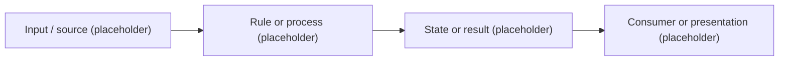

# Variable Relationship Map

Use this map to explain verified 05 state variables and cross-system dependencies both visually and in text. No 05 application state model or variable relationships have been implemented yet. The [transition overview](Winemaker04_to_05_Transition_Overview.md) describes design direction and 04 examples, not current 05 variables.

## Reading and maintenance rules

- Add relationships only after checking the relevant 05 source. Cite the owning files or symbols and link to [application flow](application-flow.md) for detailed behavior.
- Arrows represent data dependencies; they do not imply execution order. Explain commands, tick timing, side effects, and ordering in text where relevant.
- Identify state ownership, inputs, transformation or formula, consumers, and the action or process that changes each value. Distinguish persisted, derived, current, and historical snapshot values when applicable.
- Update diagrams and their textual descriptions together when a cross-domain dependency changes. Record meaningful invariants, boundaries, and player-facing uses; keep isolated implementation details in the owning module or document.
- Keep proposed models clearly separate from this verified map. Do not fill it with 04 variables, counts, or formulas.

## Visual diagram template

The following is a generic placeholder showing the format, not a 05 design or implemented flow. Replace it with source-verified diagrams as systems are added; use multiple focused diagrams when one becomes too crowded.

## Textual relationship index

| Variable or group | Owner and state kind | Inputs and transformation | Consumers / changing actions | 05 source |
|---|---|---|---|---|
| No verified entries yet | — | — | — | — |

## Timing, invariants, and visible effects

Add source-verified timing or snapshot distinctions, cross-domain invariants, and player-facing surfaces here as they become relevant. Explain each diagram in text so the map remains useful without a Mermaid renderer.
