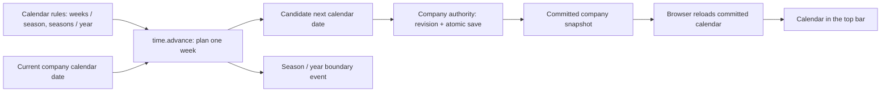

# Variable Relationship Map

Use this map to explain verified 05 state variables and cross-system dependencies both visually and in text. The [transition overview](Winemaker04_to_05_Transition_Overview.md) describes design direction and 04 examples, not current 05 behavior.

Winemaker04 has a deepwike that describe much of the code nicely
https://deepwiki.com/gram12321/winemaker04 

## Reading and maintenance rules

- Add relationships only after checking the relevant 05 source. Cite the owning files or symbols and link to [application flow](application-flow.md) for detailed behavior.
- Arrows represent data dependencies; they do not imply execution order. Explain commands, tick timing, side effects, and ordering in text where relevant.
- Identify state ownership, inputs, transformation or formula, consumers, and the action or process that changes each value. Distinguish persisted, derived, current, and historical snapshot values when applicable.
- Update diagrams and their textual descriptions together when a cross-domain dependency changes. Record meaningful invariants, boundaries, and player-facing uses; keep isolated implementation details in the owning module or document.
- Keep proposed models clearly separate from this verified map. Do not fill it with 04 variables, counts, or formulas.

## Calendar and company transition

## Textual relationship index

| Variable or group | Owner and state kind | Inputs and transformation | Consumers / changing actions | 05 source |
|---|---|---|---|---|
| Calendar rules and date | Calendar; part of company state | Explicit weeks per season, seasons per year and an initial date are validated. A time command plans one week and calculates boundary flags. | The authority commits the candidate and the browser reloads the committed date for the top bar. Boundary events are returned by the command but are not displayed. | [Calendar.ts](../../src/game/calendar/Calendar.ts), [AdvanceTime.ts](../../src/game/simulation/AdvanceTime.ts), [ConnectedApp.tsx](../../src/client/ConnectedApp.tsx), [App.tsx](../../src/App.tsx) |
| Company revision | Authority and storage; committed state metadata | Each accepted command is committed with the expected revision and a receipt. | Company sessions publish a confirmed snapshot; stale writes are rejected. | [session.ts](../../src/authority/session.ts), [PostgresCompanySavePort.ts](../../src/server/postgres/PostgresCompanySavePort.ts) |

## Timing, invariants, and visible effects

The calendar receives one explicit `time.advance` command and calculates the next week, plus whether that step crosses a season or year boundary. It does not mutate the committed state. The authority can then commit the whole candidate with a new revision; a failed or unresolved commit does not publish that candidate. The browser reloads the committed date and shows it in the top bar. No other domain phases are implemented yet.
