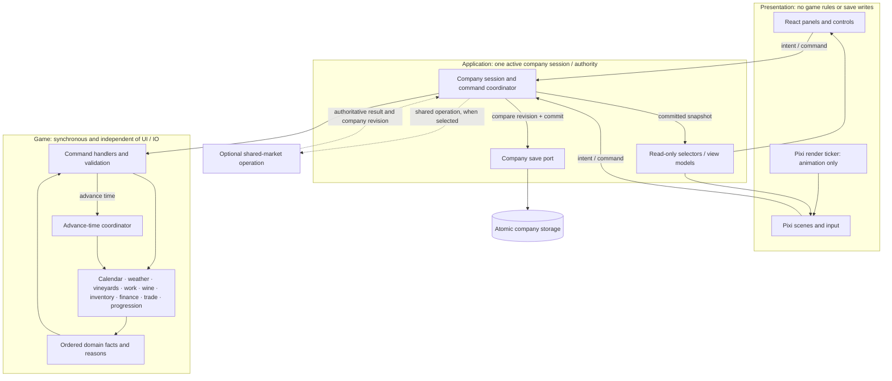

# Winemaker05: technical architecture proposal

**Status:** Research-backed proposal, 14 November 2026; the user accepted the 43 numbered recommendations discussed from it on 15 November 2026. The authoritative decision record is [design.md](design.md#agreed-architecture-and-product-decisions--15-november-2026). This document is not a description of implemented 05 code.

**17 November update:** The pre-release policy in [design.md](design.md) supersedes earlier save-version and compatibility proposals. Use only the current schema; do not add version checks, legacy handling or save migrations.

**Purpose:** Define a concrete code architecture for the company simulation: who owns state, how commands and game time move through the system, where changes commit, and how presentation and shared services connect. The [transition overview](Winemaker04_to_05_Transition_Overview.md) owns the wine-design context; the [supporting-system research](Winemaker04_to_05_System_Migration_Research.md) owns the broader migration inventory. This proposal turns their directions into candidate code contracts and ordering, without deciding their open gameplay questions.

**Scope boundary at the time of this proposal:** Winemaker05 had no application source or save provider yet. The intended stack was TypeScript, Vite, React, and PixiJS. The approved [alpha UI plan](plans/2026-11-13-alpha-ui-design-plan.md) was a navigation and placeholder prototype with no simulation or persistence requirement. The architecture below describes the subsequent playable systems. For the implemented foundation, see [application flow](application-flow.md) and [project information](PROJECT_INFO.md).

**Reading guide:** Section 1 gives the recommended architecture; sections 2–7 specify candidate code and execution contracts; sections 8–10 walk through concrete transactions; sections 11–12 preserve the earlier choices and verification scenarios; section 13 traces the evidence. The later decision record takes precedence wherever this research draft says an approved direction is proposed or open. Names, code shapes and paths remain illustrative; explicit qualifications and remaining design questions in the decision record still apply.

## 1. Recommendation in one diagram

Use **one authoritative company state per company**, advanced by **one command coordinator**, with a **synchronous, deterministic simulation** and an **atomic company commit**. A command may touch several domain owners, but the player sees either the committed result of the whole command or no new result. Trading that affects multiple companies or shared market state needs an authority that covers those shared facts.



This is a **state-transition architecture**, not an event-sourced game. The current company state is authoritative. Domain events describe facts from a successful transition; an event log is not required to rebuild the game. Some history and notifications may need durable records, but their contents and retention are separate decisions.

The diagram describes logical roles, not necessarily one browser process. In a local game the coordinator and rules can run on the device. In a server-authoritative game they run at the trusted authority and the browser session is a command/read proxy; the shared-market operation may be hosted by that same authority. A client must never submit an already-calculated company state as a trusted market or company result.

The crucial separation is:

1. **Presentation** asks for an action and displays a committed revision. It never decides a game's outcome.
2. **Company session** serializes commands, loads/saves the company, manages failure and publishes revisions. It does not calculate wine or wages.
3. **Simulation** validates and computes an entire candidate result in memory. It performs no network, database, DOM, React, Pixi, wall-clock, or global-random calls.
4. **Domain modules** own their facts and rules. The tick coordinates their order; it does not become the place where every formula lives.
5. **Persistence** atomically stores the successful company transition and its deduplication receipt. The choice of provider and physical schema is open.
6. **Shared trade**, if implemented, runs where all affected inventories, money and listing state can be authoritatively settled. A browser snapshot alone cannot guarantee that.

## 2. What the inspected code teaches us

| Source | Actual code observation | Consequence for 05 |
|---|---|---|
| 04 [header][w04-header] → [tick][w04-tick] | A button calls `processGameTick`; a module flag prevents a second concurrent call in that runtime. The tick advances calendar/weather, updates vineyards, progresses activities and starts several weekly tasks. | Keep one obvious entry for advancing time, but serialize **all** state-changing commands and commit a tick as one transition. The flag is not a cross-tab lock or a transaction. |
| 04 [state service][w04-state] and [game-state DB][w04-state-db] | Active company and partial game state live in module globals; company fields and `game_state` are saved separately. Some errors are swallowed or treated as no record. | Session identity, load outcome, authoritative state and save failure must be explicit. A read error cannot create a new company save. |
| 04 [weekly tasks][w04-weekly], [fermentation][w04-fermentation], [feature risks][w04-features], [batch upsert][w04-upsert] | Fermentation and feature-risk tasks are started in parallel. Both can update a batch's characteristics, scores, breakdown and anchors; the batch adapter reads and upserts a full row. Bottled aging was explicitly moved after other batch writers. | Use one wine-development result per lot and commit it once. Parallel tasks that read stale rows and overwrite overlapping fields are not independent. This is a source-level race risk, not a runtime reproduction. |
| 04 [activity progression][w04-activities] and [work preview][w04-work-preview] | Actual work uses the preview calculation, applies weather/storage limits, persists progress, and awards XP for applied work; partial harvest can change vineyard and lot state before the activity progress write. | Preserve shared preview/work calculation and applied-work XP. Put vineyard, lot, allocation, activity and XP changes inside the same company transition. |
| 04 [prestige hook][w04-prestige-hook] | A mounted React hook watches global refreshes and performs weekly prestige and relationship decay. | Recurring rules belong in the tick, even when no screen is mounted. UI subscriptions observe committed results only. |
| 04 [weather][w04-weather] and [feature risk][w04-random] | Weather uses date/company-derived seeds; a feature manifestation uses `Math.random()`. | Make every simulated random input explicit and reproducible, including forecasts and risk. Do not assume all of 04 is deterministic. |
| 04 [vessel exposure][w04-vessel] | Contact and expression calculations exist, but a source search found only their declarations in `src`. The [bottling path][w04-bottle] calls a storage-backed RPC, then separately records a log and applies event features. | Connect actual vessel context to wine development. Preserve 04's useful transaction-oriented vessel work, while defining a wider atomic boundary for 05 lot changes and any required historical facts. |
| [VisualIdle store][v-store], [simulation][v-simulation], [clock][v-clock], [boot/save wiring][v-main] | A store exposes a snapshot, commands and subscribers. Simulation advances to calculated boundaries; a separate wall-clock adapter drives it. Invalid saves suppress automatic overwrites. | Borrow the separation, pure transition and load-protection ideas. Its real-time behavior and specific map snapshot are not 05 decisions. |
| [Industri runtime][i-runtime], [time observer][i-clock], [company session][i-session] | The runtime stages multiple cloned domains and publishes a combined store update; a separate observer measures foreground time. Company activation saves the outgoing snapshot, but invalid/missing incoming snapshots can take the starting-state path. | Stage one combined transition and make company switching explicit. Preserve invalid data instead of treating it as a new save. A combined in-memory update alone is not durable atomicity. |
| Industri [facility production][i-facility] | A separate module derives paused/missing-input/producing status and advances facilities in a defined type order. | Put activity and equipment status calculations next to their domain rules. Compare the explicit ordering, but do not turn wine into an industrial recipe or import its units. |
| Office Tycoon [tick result][o-tick], [advance hook][o-advance] and [tick hook][o-hook] | The engine returns date, project results, events and XP. React hooks separately update multiple stores, payroll, prestige and sales. | Borrow result-oriented contracts and shared work calculation, but move orchestration out of React and commit affected state together. |
| [SkiClicker engine][s-engine] | A central fixed-step engine has an explicit order and a manual tick, but invokes systems that use multiple stores. | A central list of calls is useful, but it is not sufficient evidence of one atomic state transition. |
| [TraderGame01 settlement][t1-trade], [04 global purchase][w04-market-sql], [TraderGame04 persistence][t4-save] | TraderGame01 groups buyer, seller and listing updates in a transaction, with reservation and retry-side-effect caveats. The inspected 04 SQL locks a listing but accepts client-supplied cost and batch data. TraderGame04 writes player state and deletes/reinserts buildings through separate requests. | Design authority, validation, concurrency and idempotency explicitly; neither a database lock nor a serialized client save makes a whole cross-domain or cross-company operation safe by itself. |
| [Simulus tick][m-tick] and [market storage][m-market] | Its weekly function orchestrates domains but also updates displays and uses a locally stored “global” market. | A centrally named tick or “global” market does not establish a server-owned authority. |

Detailed source revisions, links, and limits are in section 13. The observations are from source inspection; these games and their databases were not run for this proposal.

### The actual 04 execution path

The main path at the inspected 04 revision is approximately:

```text
Header.handleIncrementWeek
  -> processGameTick: in-process busy guard and minimized-modal check
  -> executeGameTick
       -> calculate next week; on a boundary run new-year / season handlers
       -> resolve forecast and weather
       -> updateGameState: update in-memory date, then company / game_state writes
       -> update vineyard ripeness and health
       -> progress activities: work, partial harvest, progress writes, XP, completions
       -> processWeeklyEffects
            -> start order / contract, fermentation, feature-risk and prestige tasks
               concurrently; run applicable market, wages and loan work
            -> schedule achievement check without awaiting its completion
            -> wait for the weekly tasks, then feature consistency and bottled aging
            -> emergency-loan check
       -> bookkeeping trigger, time notification, highscore work and UI refresh

Separately: global refresh -> mounted usePrestigeUpdates hook
  -> company-value refresh and, on observed date change, prestige / relationship decay
```

The hook can react to refreshes independently of the final tick refresh. Many individual weekly failures are caught and logged, while the date and earlier effects may already have been written. The 04 bottling and market paths also contain database RPCs, so this is not a claim that 04 has no transactional operations; the point is that the **whole weekly advance** is not one demonstrated atomic transaction. See [tick][w04-tick], [state][w04-state], [activity progression][w04-activities] and [prestige hook][w04-prestige-hook].

## 3. Proposed code layout and dependency direction

This is a target layout, not a claim that these files already exist. Start with the modules actually needed by the first playable slice; do not create empty layers merely to match this tree.

```text
src/
  app/
    bootstrap.ts                  # creates session, adapters, UI and scenes
    session/
      CompanySession.ts           # activate / close one company
      CommandCoordinator.ts       # queue, commit, publish and recover
    persistence/
      CompanySavePort.ts          # load / atomic commit contract
      ...chosen adapter...        # provider-specific code, once selected
  game/
    core/
      CompanyState.ts             # assembles domain-owned state types
      Commands.ts                 # command union / shared IDs
      Results.ts                  # typed rejection, transition and events
    simulation/
      AdvanceTime.ts              # orders one company-time transition
      TickPhases.ts               # explicit phase composition
    calendar/                     # game-date arithmetic / boundaries
    weather/                      # forecast and interval weather
    vineyard/                     # site, vines, crop and harvest rules
    work/                         # people, assignments, activities, work
    inventory/                    # quantities, custody and allocations
    equipment/                    # vessels, capacities, condition and upkeep
    wine/                         # material, process and development rules
    evaluation/                   # sensory projection and moving targets
    finance/                      # money, ledger, loans and due payments
    commercial/                   # company orders, contracts and customers
    progression/                  # research, gates, achievements and prestige
    queries/                      # cross-domain read models, never writes
  ui/                             # React shell, panels, accessibility
  scenes/                         # Pixi lifecycle, drawing, scene input
```

Dependency rule: `app` composes the system and knows the save adapter; `simulation` imports domain rules and shared types; a domain rule receives the specific facts it needs and does not import React, Pixi, the save adapter or a global active-company service. `CompanyState` assembles domain types; domain rules must not depend on the assembled state or on the coordinator. `queries` may compose read-only results across domains. UI and scenes consume session operations and query results, rather than reading a database or writing domain state.

Use direct, explicit calls for cross-domain work. No generic service locator, global event bus, or per-domain repository hierarchy is needed to establish these boundaries. Split files further when real behavior makes that useful.

## 4. Ownership: one fact, one writer

| State or decision | Proposed owner | Other modules may do |
|---|---|---|
| Company identity, current committed revision and session lifecycle | Application session; persistent identity/revision in the save boundary | Read the active session; request a switch. Domain rules receive an explicit company ID. |
| Game date and season/year boundaries | Calendar | Ask for a date or boundary facts. A React timer or scene never edits the calendar. |
| Weather state, forecast and resolved interval context | Weather | Vineyard and work read the context; the UI formats a forecast. |
| Site, vines, crop, ripeness and harvestable material | Vineyard | Work requests/executes vineyard operations; wine receives harvested material and origin/potential inputs. |
| Staff, competencies, assignments, activity progress and applied work | Work/people | Vineyard, wine, research and maintenance expose operation-specific requirements and outcomes. Finance posts wages. |
| Physical lot composition, inherited potential, process settings, evolving wine state and wine-related conditions | Wine | Equipment and inventory supply the actual environment and placement; evaluation interprets the state. Wine never directly edits a score. |
| Quantities, custody, location, reserved capacity and lot-to-container allocation | Inventory/allocation | Equipment provides vessel capacity and condition. Wine provides a material state per lot. Trade requests transfers through inventory rules. |
| Vessel identity, properties, condition, maintenance and capability | Equipment | Inventory owns occupancy/reservation links; wine reads an environment assembled from both. No second independent occupancy field is authoritative. |
| Current sensory profile, readiness, quality assessment and explanation | Derived by wine/evaluation queries | Recalculate from authoritative material, context and evaluation configuration. Persist a historical assessment only for a specific business event when required. |
| Company cash, postings, loan terms and payment history | Finance | Other domains request a posting as part of a coordinated transition; UI does not subtract cash itself. |
| Customer relations, orders and company contracts | Commercial | Read wine evaluation, inventory availability, finance and origin reputation via explicit inputs. A shared listing is owned by the shared authority, not a company read model. |
| Research, gates, achievements and prestige | Progression, with domain-specific effects interpreted by their consumer | Commands enforce the same gate calculation used by UI explanations. A successful unlock and any gameplay reward are part of one transition. |
| UI navigation, selection, open panels and transient animation | React shell / Pixi scene | May select a lot ID or send an intent; no domain state is inferred from the current page or animation. |

### Lot and quantity boundary

The proposed inventory model owns **how much and where**; the wine model owns **what the material is and how it develops**. A `LotId` identifies a physically coherent wine state. Inventory holdings refer to that ID and carry the authoritative quantity and custody/placement. The wine record must not contain a competing mutable total quantity.

If portions can experience different vessel or storage conditions, they cannot silently share one evolving physical state. The recommended representation is to split them into separately developing lots with lineage to the same commercial wine identity; aggregation in the cellar is a query. The precise split/merge rules, units and commercial identity remain design decisions. A transfer, split, blend, bottling or sale must preserve the chosen material-balance rules and update all affected records in one transition.

This separation is especially important for partial harvest and a wine spread over vessels. It prevents one quantity being decremented in inventory while another copy remains in a batch or a scene.

## 5. Command execution and the company session

The intended public shape is small. These are illustrative TypeScript contracts, not existing types or a finished API:

```ts
type GameCommand =
  | { type: 'time.advance' } // one configured player advance
  | { type: 'harvest.start'; vineyardId: VineyardId; staffIds: readonly StaffId[] }
  | { type: 'wine.bottle'; lotId: LotId; amount: MaterialAmount }
  | { type: 'activity.cancel'; activityId: ActivityId };

type CommandEnvelope = {
  companyId: CompanyId;
  commandId: CommandId;       // stable across retries of this intent
  expectedRevision: number;
  command: GameCommand;
};

type Transition = {
  next: CompanyState;
  events: readonly DomainEvent[];
  explanations: readonly RuleTrace[]; // diagnostic / player explanation, as needed
};

type DispatchResult =
  | { kind: 'committed'; revision: number; events: readonly DomainEvent[] }
  | { kind: 'already-committed'; revision: number }
  | { kind: 'rejected'; reasons: readonly RuleFailure[] }
  | { kind: 'conflict'; currentRevision: number }
  | { kind: 'failed'; reason: string }       // definitely not committed
  | { kind: 'unknown'; commandId: CommandId }; // outcome must be resolved

type CompanySnapshot = {
  readonly companyId: CompanyId;
  readonly revision: number;
  readonly state: CompanyState;
};

interface CompanySession {
  dispatch(input: CommandEnvelope): Promise<DispatchResult>;
  getSnapshot(): CompanySnapshot;
  subscribe(listener: () => void): () => void;
}
```

`dispatch` is an application operation, not a React hook. The coordinator performs this sequence:

```text
queue command for this company
  -> check active company; resolve any existing command receipt first
  -> if no receipt: check expected committed revision
  -> evaluate command and all mandatory consequences against a candidate state
  -> if domain validation fails: return reasons, publish nothing
  -> atomically commit candidate state + new revision + command receipt
  -> after confirmed commit: replace the session snapshot, notify subscribers
  -> present transient feedback / deliver eligible external effects
```

The domain transition is synchronous and side-effect free. A `harvest.start` handler can call work, vineyard, inventory and finance rules using explicitly supplied data. The coordinator threads the resulting state through those calls; individual domains produce their own changes, while the command handler coordinates cross-domain invariants.

The central dispatch inside the simulation can be an ordinary explicit switch:

```ts
function decideCommand(state: CompanyState, command: GameCommand, rules: Rules): Decision {
  switch (command.type) {
    case 'time.advance':    return accept(advanceCompany(state, rules));
    case 'harvest.start':   return startHarvest(state, command, rules);
    case 'wine.bottle':     return bottleWine(state, command, rules);
    case 'activity.cancel': return cancelActivity(state, command, rules);
  }
}
```

Each called handler composes domain-owned rules and returns either a complete candidate transition or rejection reasons. This switch is the command router; the tick in section 6 is only the handler for `time.advance`. Neither is a second store, a persistence implementation or an excuse to place domain formulas in one large file.

`CompanyState` and its nested domain collections are deeply read-only at the public boundary; a shallow TypeScript `Readonly<T>` is insufficient. A transition may use private copy-on-write drafts, but must never mutate the previously published snapshot or hand mutable aliases to UI, scenes or adapters. The session returns the same snapshot object until a committed revision changes, then publishes one replacement; React and Pixi subscriptions can read that coherent revision and unsubscribe with their owning lifecycle. On a receipt replay, refresh the authoritative snapshot if needed and do not emit the original transient effects again.

The local queue prevents interleaving within one session. It does **not** protect against another tab, device or server worker. The save authority must compare the expected company revision and atomically reject a stale write. On conflict, reload and re-evaluate against the authoritative revision; do not silently overwrite it. Company switching waits for the current operation to settle, loads and validates the incoming company, and only then publishes the new session. If loading or saving fails, keep the existing active company and report the failure.

Commands and tick stages return typed failures for expected problems such as unavailable capacity or an unmet gate. Unexpected calculation errors abort the candidate transition. They must not be caught independently and reported as a fully successful tick after the date was already saved.

### Events are facts, not hidden control flow

Events such as `HarvestProgressed`, `LotCreated`, `WineBottled`, `PaymentPosted` or `ResearchCompleted` are typed descriptions of things that occurred. Their exact names are illustrative. Rules that change gameplay state—XP, cash, unlocks, awards, inventory, contractual consequences—are applied by explicit ordered calls **before** the commit. A subscriber cannot secretly mutate the game.

After commit, subscribers can refresh views or show a toast. The agreed direction includes durable company notification history and account/company read state; construct required history records in the transition while keeping read state and presentation preferences scoped separately. If an external leaderboard or service must receive an event reliably, save an outbox entry in the same transaction and deliver it afterward with a stable event ID. That outbox is conditional on such an integration, not a prerequisite for the UI alpha. Delivery is at least once unless the receiving side also deduplicates.

## 6. Game time and the central tick

The **calendar is the game clock**. The **tick is the operation that advances the company simulation from one game-time boundary to the next**. The **Pixi frame ticker only animates or redraws**. None of those implies an automatic wall-clock timer.

The approved UI alpha has an Advance Time placeholder. For the subsequent playable game, the agreed starting direction is manual advancement by one game week per action, with daily internal wine steps subject to validation. Automatic progression and fast-forwarding can use the same command later; offline play and synchronization are deferred. Do not invoke game rules directly from `requestAnimationFrame`, React effects, or the Pixi ticker.

### Proposed interval semantics

For an interval `[t, t + Δ)`, use a single candidate state and explicit stages. This order was accepted as the starting direction; it does not decide the final wine or finance rules:

| Order | Coordinator calls | Reads → writes | Why here |
|---|---|---|---|
| 1 | `calendar.planAdvance`; `weather.resolveInterval` | Current date, weather/seed → interval, boundary flags and weather context | All domains receive the same date and weather; no date is persisted yet. |
| 2 | `vineyard.advanceEnvironment` | Vineyard state + interval weather → candidate crop/health/ripeness | Weather-driven vineyard state is available before interval harvest output is applied. |
| 3 | `work.calculateAndProgress` | Starting assignments, activity requirements, research effects, weather and available capacity → applied work, XP inputs and pending operation outcomes | One allocation calculation supplies both previews and execution. Resource contention is resolved by a documented stable priority, not array iteration or promise timing. |
| 4 | `wine.advanceExistingLots` | Lots present at `t`, their actual allocations/vessels, process config and interval → one updated physical state per lot | Fermentation, extraction, maturation and faults share one result. A lot created at the end boundary does not develop retroactively for the whole interval. |
| 5 | `applyWorkOutcomes` via vineyard, wine, equipment, inventory and research handlers | Applied work and end-of-interval state → partial harvests, completions, new lots, reservations, maintenance and XP | Partial work can produce partial output each interval. Completion, resource usage and actual-work XP are coordinated together. Newly completed setup applies from this boundary onward. |
| 6 | Calendar-bound finance and commercial handlers | Boundary flags, ledgers, eligible inventory and prior results → wages, scheduled debt, contract deadlines and other due facts | Specify ordering and insufficient-cash policy explicitly. On a season/year boundary, each due item is processed once. |
| 7 | Progression, prestige and required history | Ordered facts and the candidate state → unlocks, rewards, decay and any required historical records | Consequences are deterministic and part of the same candidate; presentation does not drive them. |
| 8 | `calendar.finishAdvance`; invariant validation | All candidate changes → final date and transition | The coordinator commits only after all required stages succeed. Derived views are read after commit. |

Example: an existing fermenting lot develops during the interval. If harvest work creates grapes at `t + Δ`, those grapes exist for the next interval; they do not receive a full interval of fermentation just because the activity and wine phases happen in the same button press. If a partial harvest creates an increment each interval, that increment is effective at the corresponding boundary. This is a coarse policy: if mid-interval timing matters, the coordinator must split the interval at the completion/depletion boundary and advance the remaining segment. It must not pretend a boundary completion happened earlier.

```ts
// Sketch: each call returns a candidate state plus facts; no persistence occurs here.
function advanceCompany(state: CompanyState, rules: Rules): Transition {
  const interval = calendar.planAdvance(state.calendar, rules.calendar);
  const weather = weatherRules.resolveInterval(state.weather, interval, state.random);
  let draft = withWeather(state, weather);
  const events: DomainEvent[] = [];

  draft = vineyard.advanceEnvironment(draft, interval, weather, events);
  const work = workRules.calculateAndProgress(draft, interval, weather);
  draft = wineRules.advanceExistingLots(draft, interval, weather, events);
  draft = applyWorkOutcomes(draft, work, interval.end, events);
  draft = applyDueFinanceAndCommercialRules(draft, interval, events);
  draft = applyProgressionAndHistory(draft, interval, events);
  draft = calendar.finishAdvance(draft, interval);
  assertCompanyInvariants(draft);
  return { next: draft, events, explanations: [] };
}
```

The sketch shows the orchestration, not required signatures. In production, domain functions should receive their own slices and narrowly defined inputs rather than importing the full `CompanyState`. `events` must have a fixed ordering and must not be a mutable global. The actual work and wine formulas, phase order at simultaneous boundaries, and whether substeps are necessary remain to be designed. Do not run two candidate stages in parallel unless their read/write sets and deterministic merge are proved independent.

### Determinism and forecasts

- Pass a company seed and stable context—such as game interval, subsystem, entity ID and purpose—to random rules, or persist the PRNG state. If using a stateful PRNG, include its advanced state in the candidate and commit it with the game; the sketch above illustrates keyed context rather than a stateful stream. Define the selected algorithm and stable entity order in the implementation. IDs generated during a transition must also be reproducible or supplied as explicit command inputs.
- Given the same input state, command, rule/catalog version and random context, a transition should produce the same result. This is not a promise that old saves replay identically after rules change, or that different numerical step sizes produce exactly the same result.
- A preview runs the same calculation against a copy and discards its result. A forecast may instead use a stated range or multiple scenario seeds; do not disclose hidden future random outcomes merely because the engine can reproduce them. Never consume the live random sequence or apply a reward during a preview.
- Fixed canonical substeps or explicit next-boundary handling are candidates. Compare results under the **same** stepping policy, and test any acceptable numerical error when splitting intervals. Decide the actual step size and tolerance with the wine model.

## 7. Wine-development interface

The tick calls a wine coordinator; the wine coordinator calls the process rules. Neither the tick nor the scene computes tannin, fermentation, scores or vessel effects.

```text
vineyard harvest facts ──> inherited raw-material potential ─┐
                                                           │
current material + process settings + elapsed interval ─────┼─> developLot
actual location + vessel + condition + storage environment ─┤       │
explicit random context ────────────────────────────────────┘       ├─> next material / process state
                                                                    ├─> conditions and domain facts
                                                                    └─> traceable causes

next material + origin + context ──> sensory projection ──> moving-target evaluation
                                                        └──> commercial queries
```

```ts
type WineDevelopmentInput = {
  material: WineMaterialState;
  amount: MaterialAmount;        // read from inventory; no second stored total
  rawPotential: RawMaterialPotential;
  processes: WineProcessState;   // settings and current process progress
  conditions: readonly WineCondition[];
  environment: WineEnvironment; // resolved from actual placement and equipment
  interval: GameInterval;
  random: RandomContext;
};

type WineDevelopmentResult = {
  material: WineMaterialState;
  processes: WineProcessState;
  conditions: readonly WineCondition[];
  inventoryEffects: readonly InventoryChangeProposal[];
  events: readonly DomainEvent[];
  causes: readonly RuleTrace[];
};

function developLot(input: WineDevelopmentInput): WineDevelopmentResult;
function deriveSensory(input: SensoryInput): SensoryProfile;
function evaluateSensory(profile: SensoryProfile, context: EvaluationContext): Assessment;
```

Potential, material and process fields above are placeholders, not a selected chemistry schema. In this proposal `rawPotential` is the inherited baseline; consumption or degradation of what remains available is mutable material/process state. The wine engine receives the inventory amount as an input and proposes any loss, conversion or other quantity effect; inventory validates and applies it within the same candidate transition, retaining one authoritative quantity. The implementation must define whether interacting reactions are sequential or jointly solved, their inputs and conservation constraints, and the order/accuracy of any substeps. Current assessments and readiness are derived; historical facts such as an assessment at bottling, if required, are explicit snapshots with an event/date and are not later overwritten by a current query. Bottled lots continue through the same development entry point with a different environment; bottling does not start an unrelated aging engine.

## 8. Walkthrough: start and advance a harvest

**At date `t`:**

```text
React or scene selection
  -> session.dispatch(harvest.start, vineyardId, staffIds, commandId, revision)
  -> work checks assignments and activity eligibility
  -> vineyard checks that the requested operation can start
  -> inventory + equipment check/reserve the required capacity, if the design requires it
  -> finance checks/posts any approved start cost
  -> work creates the activity; transition returns one candidate company state
  -> save authority commits activity + reservations + postings + receipt together
  -> session publishes revision N+1; UI reads the committed activity / availability
```

The displayed “can start?” and estimated work use the same rule functions as execution, but execution rechecks the committed state. A stale preview is not authorization. If capacity or a gate fails, no staff assignment, reservation, money change or activity is committed.

**When time advances:** weather and vineyard rules update the interval context; work calculates actual permitted effort; vineyard computes any harvestable increment; inventory/allocation checks the physical placement; wine creates or updates an appropriate lot and origin/potential; work records applied progress and awards XP for actual applied effort. The candidate also includes other interval effects. If a mandatory operation fails, none of the interval—including its date—is published. If capacity merely limits the work, that is a normal domain result: commit only the permitted work, output and XP, with a blocking reason.

This is the specific boundary suggested by 04's useful partial-harvest and applied-XP paths, while removing the possibility that the lot changes and activity progress are independently committed during the same tick.

## 9. Walkthrough: bottle, evaluate and sell

For `wine.bottle`, the command validates wine readiness, amount and any required equipment using current rules. Wine determines the physical transformation and continuing process context. Inventory consumes the source holding and creates the bottled holding/lot or portion; equipment/allocation releases only the capacity actually freed. Any required bottling assessment and production-history facts are recorded at that date. The command commits all of this together, including any finance posting. The exact bottle quantity, units, yield and lifecycle representation are open.

The cellar view then combines current inventory and location with **derived** sensory and evaluation results. A commercial valuation consumes the current assessment, Origin Prestige and the relevant market/customer context; it does not alter the physical wine. A sales command verifies eligibility, available quantity and price at its authority, then coordinates inventory, finance, contract and reputation changes in a single company transaction for a purely local/NPC sale.

A later time advance develops the bottled lot using its closure and storage environment. Historical bottling facts stay historical while current sensory and commercial queries change.

## 10. Persistence, concurrency and authority

### Company save contract

The storage implementation may use a serialized snapshot, normalized records or both. The observable contract is the same: load a **coherent company revision**, and atomically compare and commit all company changes needed for a command. A sequence of unrelated table writes or a debounced series of domain saves does not satisfy that contract on its own.

This is an internal authority-to-storage interface. With a server authority, the trusted server loads state and runs the command/rules before calling `commit`; it must not accept `next` as a client-authoritative snapshot.

```ts
type LoadCompanyResult =
  | { kind: 'loaded'; revision: number; data: SerializedCompany }
  | { kind: 'not-found' }
  | { kind: 'invalid'; details: string }
  | { kind: 'unavailable'; details: string };   // read failed; existence unknown

interface CompanySavePort {
  load(companyId: CompanyId): Promise<LoadCompanyResult>;
  commit(input: {
    companyId: CompanyId;
    expectedRevision: number;
    commandId: CommandId;
    commandFingerprint: string;
    next: SerializedCompany;
    durableEffects: readonly OutboxItem[];
  }): Promise<CommitResult>;
  getCommandReceipt(companyId: CompanyId, commandId: CommandId): Promise<ReceiptResult>;
}
```

The adapter must implement these behaviors:

1. **Load:** validate the current required fields, finite/range values, IDs and cross-references before constructing the runtime state. `not-found` alone permits an explicit new-company flow; creation must also atomically check that no company save appeared concurrently. Invalid and unavailable saves are preserved and must not be auto-overwritten during normal operation.
2. **Commit:** atomically check revision, write all company facts and the new revision, and record the command ID, semantic payload fingerprint and result receipt. If a durable external effect is required, store its outbox record in that same transaction. A provider must actually support this atomic scope; an interface alone does not provide it.
3. **Repeat:** look up the command ID before rejecting a stale revision or evaluating it as a new attempt. The same ID and semantic payload returns the original receipt without applying the transition or toast again. The same ID with a different semantic payload is an error. The expected revision is a concurrency precondition, not part of the semantic payload fingerprint. Retain receipts for the supported retry horizon; do not prune them while an old command can still be retried without another durable deduplication record.
4. **Known failure:** if the authority confirms no commit occurred, retain the previous committed snapshot and expose a retryable failure. Do not report success or advance the displayed date.
5. **Unknown outcome:** after a timeout or lost response, do not assume rollback. Resolve the command receipt against the authority, or retry the exact same ID and payload with atomic deduplication. Until resolved, do not issue a conflicting mutation as if the first outcome were known. A receipt query may itself be temporarily unavailable or pending.
6. **Conflict:** a different writer has committed a later revision. Reload it and revalidate the intended command; never replace it with a stale whole-company snapshot. Do not automatically repeat an irreversible player choice against changed conditions.

For a local-only provider, the same atomic revision/receipt rule still matters across tabs. A plain in-memory mutex or independent browser-storage keys do not establish cross-tab compare-and-swap. Select an appropriate transactional local mechanism when a local provider is actually chosen. For a server provider, the check and writes must be one authoritative database transaction or equivalent. Company switching and session teardown must respect in-flight or unresolved commands; a late response from the old company must not replace the new company's state.

This commit-before-publish policy adds storage latency to each accepted command, particularly with a remote authority. Show a pending state and avoid blocking rendering while the command is in flight. If future automatic high-frequency simulation needs grouped commits or a bounded loss window, specify that as a different durability policy with its own recovery behavior; silently debouncing writes would weaken the contract. A long multi-interval request may instead commit explicitly reported intervals one by one, but then partial advancement is an intentional result rather than an all-or-nothing command.

Persist **authoritative** calendar, vineyards, lots, holdings/allocations, equipment, activities, people, finance, contracts, research and any chosen durable history, plus the reproducibility metadata required by the selected rules. Rebuild current evaluation, summaries, view models and other caches on load. Use the current schema directly without save-version checks or migrations for older development saves.

### Shared market: a separate authority decision

The recommended architecture for an enforceable shared market is a server-side company/market authority that owns the transaction across the relevant listing, seller and buyer company revisions, inventory/custody, price, payment and delivery. It authenticates the actor, derives/validates the authoritative price and lot data, uses a stable command ID, and records the settlement once. Clients send an intent and refresh affected company revisions from the authority; a stale offline snapshot cannot overwrite the result.

```text
buyer intent -> shared authority
  -> validate identity + listing + authoritative price + availability
  -> atomically reserve/transfer the goods and apply buyer/seller money and listing changes
  -> record command receipt and any durable delivery/outbox records
  -> publish committed revisions / result to the relevant sessions
```

If listing custody, company state and payment cannot share a transaction, a durable reservation/settlement workflow with explicit pending, completion, compensation and idempotency is needed; a client-side sequence of calls is insufficient. This is a materially larger design. The agreed direction is an authenticated online game with a server-authoritative asynchronous shared market and server-owned market clock, alongside local and NPC commercial systems. Offline play is deferred. The exact custody and settlement rules and the relation between real time and market time still need design.

For an inactive seller, the authority still updates the seller's canonical state and revision. If that seller is active elsewhere, the next stale write conflicts and must reload/revalidate. Global listing time must have an authority of its own or an explicitly chosen projection policy; independent company dates alone cannot establish one shared listing state.

## 11. Original alternatives and decisions

This comparison preserves the 14 November research state. For the accepted recommendations and remaining qualifications, use the [15 November decision record](design.md#agreed-architecture-and-product-decisions--15-november-2026); the status labels in this historical table have not been individually revised.

| Choice | Recommendation and trade-off | Status |
|---|---|---|
| Company runtime | One logical company state and one command coordinator, with domain-owned rules and explicit staging. This is simpler to reason about than 04-style independent writes, but can become a large coordinator if formulas are allowed into it. Keep only order and cross-domain contracts there. | Proposed here. |
| In-memory authority vs server authority | A local authority is simpler for isolated single-player simulation; a server authority supports enforceable shared trading and multi-device writers but adds latency, deployment and operational work. The same pure rules/command contract can run at either authority; the client copy is a read cache in the server case. | Provider, accounts and offline behavior open. |
| Save shape | Begin with the smallest provider-supported atomic company representation; normalized tables are acceptable if their transaction covers the same invariants. Snapshots are simpler to validate and restore, while tables may suit querying and shared operations. | Proposed contract; storage format/provider open. |
| Time step and pacing | Manual command interface now as a design seam; exact interval, automatic time, offline progress and substeps are not decided. | Open. The alpha control is a placeholder. |
| Mid-interval events | Begin with explicitly documented boundary semantics if coarse intervals are sufficient. If they are not, split at completion/depletion/deadline boundaries, as VisualIdle does for its own simulation. | Requires gameplay and numerical design. |
| Contended work/capacity/cash | Use one stable, explicit priority or allocation rule and return explanations; never depend on DB row order. Decide whether different activities can share staff, whether work can be partial and which payment has priority. | Rule details open. |
| Lot split, merge and lineage | Quantity/placement in inventory; wine owns each evolving material state. Split physically different environments into separate evolving portions; aggregate commercial identity in queries. | Proposed model; exact units and user-facing behavior open. |
| Simultaneous wine processes | One consolidated lot result with defined substep/order or a joint solver. Process components should not write overlapping saved fields independently. | Integration method and chemistry open. |
| Events and history | State transitions plus explicit facts; persist required historical records and add an outbox only for external delivery. | History, notification and delivery policies open. |
| Shared trade and market time | Prefer server authority if multiplayer trade must be enforceable. Define settlement/custody, company clocks and shared market time together. | Shared-market product and authority model open. |

## 12. Implementation slices and evidence to require

These are possible slices after the approved UI prototype, not an approved delivery schedule:

1. **Core seam:** introduce company state, explicit command/result types, calendar and a synchronous no-IO transition; exercise a manual time advance without UI or storage dependencies.
2. **First vertical transaction:** add a small vineyard, staff/work allocation, capacity and a partial harvest producing a lot. Run the same work calculation for preview and application.
3. **Wine continuation:** add one physically meaningful process, actual vessel environment, derived sensory/evaluation and bottling with continued development. Keep exact variables and formulas subject to wine design.
4. **Durable company session:** select a provider, validate the current 05 save, implement atomic revision/receipt commits and company activation; expose failures. This can be pulled earlier if the first playable slice needs persistence.
5. **Supporting systems:** connect finance, research, contracts, reputation and other adopted mechanics through explicit commands and tick phases. Introduce any shared authority only when its product and consistency model are decided.

Useful acceptance scenarios for the eventual implementation:

- Two identical states, commands, rules and random contexts produce identical transitions; a preview changes neither live state nor random progression.
- Weather affects vineyard and work in the specified interval; a boundary-created lot does not receive a full prior interval of development; partial work awards XP only for work applied.
- Vessel allocation and lot quantity remain consistent through partial harvest, cancellation, transfer and bottling; two independently developing vessel portions do not overwrite each other.
- A bottled wine continues to develop; current evaluation changes with the wine while a recorded bottling assessment remains unchanged.
- A failed stage or failed commit leaves the previous date, lot, activity, finance and reward state intact; a season/year boundary and achievement reward apply once.
- A duplicate command or lost response resolves to one receipt and one mutation; a stale second tab/device receives a conflict rather than overwriting a later revision.
- Loading an invalid or unreadable company never creates a replacement save during normal operation; switching companies never mixes their state or accepts a late old-company response.
- If shared trade is built: concurrent buyers cannot acquire the same goods, price and authorization are checked by the authority, a retry cannot charge twice, and an inactive seller's canonical revision is updated. Test transaction failure and any outbox delivery separately.

These are proposed tests, not tests that have been run. Validate the chosen provider's actual transaction and concurrency semantics, not only a mocked port.

## 13. Source coverage and pinned references

This pass followed 04's header → game tick → state/persistence, activities/partial harvest/work preview, fermentation/features/bottling, vessel calculations, prestige hook, weather and global-market SQL. It compared runtime, clock, session and persistence patterns in the sibling games below. It did not audit every formula, catalog, database migration, deployment permission, RLS policy or user journey, and did not run the games or their tests.

| Repository | Revision inspected | Relevance / limit |
|---|---|---|
| Winemaker04 | [`94fd950f0e63287f748ac5c0d7a66309add36e26`](https://github.com/gram12321/winemaker04/tree/94fd950f0e63287f748ac5c0d7a66309add36e26), local `main` | Later than the overview's `f3f4dade` and the supporting inventory's `0c5f9b3`; the links below pin the source read in this pass. |
| VisualIdle | [`8d186331e838ab49c82fb11d9452ba09a9e0b893`](https://github.com/gram12321/visualidle/tree/8d186331e838ab49c82fb11d9452ba09a9e0b893) | Read committed source with `git show`, excluding the checkout's unrelated working changes. Its clock is not a specification of offline progression. |
| Industri Clicker | [`a6c85c0b6d3b832c3a23829a134d049ecef01bbc`](https://github.com/gram12321/industriClicker/tree/a6c85c0b6d3b832c3a23829a134d049ecef01bbc) | Runtime/session source; unrelated package-file changes were not used. Its platform, foreground-time policy and SQLite provider are not 05 choices. |
| Industri facilities worktree | [`a03a5b8af2c439b63d4e37e9e07b1566373d92d8`](https://github.com/gram12321/industriClicker/tree/a03a5b8af2c439b63d4e37e9e07b1566373d92d8) | Separate facility production/status comparison; its recipe mechanics are not a wine model. |
| Office Tycoon | [`1cbabbc02ea1eb2950732b81e7f2dd2561cbd0be`](https://github.com/gram12321/officetycoon/tree/1cbabbc02ea1eb2950732b81e7f2dd2561cbd0be) | Result-oriented engine versus React/store orchestration. |
| SkiClicker | [`4cb5802d31ecb8858d0d4c2514d653ce7fd5cf0b`](https://github.com/gram12321/Skiclicker/tree/4cb5802d31ecb8858d0d4c2514d653ce7fd5cf0b) | Central fixed-step engine and ordered calls. |
| TraderGame01 / TraderGame04 | [`45ada828bd88eea11fba2cb2d62fcfe95049ef5e`](https://github.com/gram12321/tradergame01/tree/45ada828bd88eea11fba2cb2d62fcfe95049ef5e) / [`a9bd719fb6ff6773cf49033a59f02dd7a97b72ab`](https://github.com/gram12321/tradergame04/tree/a9bd719fb6ff6773cf49033a59f02dd7a97b72ab) | Settlement and persistence boundaries; no deployed security or concurrency guarantee inferred. TraderGame04's unrelated Vite config edit was not used. |
| Simulus01 | [`c39631701b0a1dcbb8ae0d13993747f5ca929336`](https://github.com/gram12321/Simulus01/tree/c39631701b0a1dcbb8ae0d13993747f5ca929336) | Manual weekly orchestration and locally stored market comparison. |

Other comparisons and domain-specific migration candidates are documented in the [supporting-system research](Winemaker04_to_05_System_Migration_Research.md). Private repository links require the user's existing access.

[w04-header]: https://github.com/gram12321/winemaker04/blob/94fd950f0e63287f748ac5c0d7a66309add36e26/src/components/layout/Header.tsx#L58
[w04-tick]: https://github.com/gram12321/winemaker04/blob/94fd950f0e63287f748ac5c0d7a66309add36e26/src/lib/services/core/gameTick.ts#L22
[w04-state]: https://github.com/gram12321/winemaker04/blob/94fd950f0e63287f748ac5c0d7a66309add36e26/src/lib/services/core/gameState.ts#L14
[w04-state-db]: https://github.com/gram12321/winemaker04/blob/94fd950f0e63287f748ac5c0d7a66309add36e26/src/lib/database/core/gamestateDB.ts#L12
[w04-weekly]: https://github.com/gram12321/winemaker04/blob/94fd950f0e63287f748ac5c0d7a66309add36e26/src/lib/services/core/gameTick.ts#L201
[w04-fermentation]: https://github.com/gram12321/winemaker04/blob/94fd950f0e63287f748ac5c0d7a66309add36e26/src/lib/services/wine/winery/fermentationManager.ts#L179
[w04-features]: https://github.com/gram12321/winemaker04/blob/94fd950f0e63287f748ac5c0d7a66309add36e26/src/lib/services/wine/features/featureService.ts#L850
[w04-upsert]: https://github.com/gram12321/winemaker04/blob/94fd950f0e63287f748ac5c0d7a66309add36e26/src/lib/database/activities/inventoryDB.ts#L326
[w04-activities]: https://github.com/gram12321/winemaker04/blob/94fd950f0e63287f748ac5c0d7a66309add36e26/src/lib/features/activities/services/activitymanagers/activityManager.ts#L515
[w04-work-preview]: https://github.com/gram12321/winemaker04/blob/94fd950f0e63287f748ac5c0d7a66309add36e26/src/lib/features/activities/services/activityWorkPreviewService.ts#L24
[w04-prestige-hook]: https://github.com/gram12321/winemaker04/blob/94fd950f0e63287f748ac5c0d7a66309add36e26/src/hooks/usePrestigeAndVineyardValueUpdates.ts#L71
[w04-weather]: https://github.com/gram12321/winemaker04/blob/94fd950f0e63287f748ac5c0d7a66309add36e26/src/lib/features/weather/weatherResolver.ts#L49
[w04-random]: https://github.com/gram12321/winemaker04/blob/94fd950f0e63287f748ac5c0d7a66309add36e26/src/lib/services/wine/features/featureService.ts#L1426
[w04-vessel]: https://github.com/gram12321/winemaker04/blob/94fd950f0e63287f748ac5c0d7a66309add36e26/src/lib/services/wine/winery/storageVesselExposureService.ts#L17
[w04-bottle]: https://github.com/gram12321/winemaker04/blob/94fd950f0e63287f748ac5c0d7a66309add36e26/src/lib/services/wine/winery/fermentationManager.ts#L76
[w04-market-sql]: https://github.com/gram12321/winemaker04/blob/94fd950f0e63287f748ac5c0d7a66309add36e26/migrations/20260720210000_add_global_grape_market.sql#L106
[v-store]: https://github.com/gram12321/visualidle/blob/8d186331e838ab49c82fb11d9452ba09a9e0b893/src/game/simulation/GameStore.ts#L105
[v-simulation]: https://github.com/gram12321/visualidle/blob/8d186331e838ab49c82fb11d9452ba09a9e0b893/src/game/simulation/GameRules.ts#L416
[v-clock]: https://github.com/gram12321/visualidle/blob/8d186331e838ab49c82fb11d9452ba09a9e0b893/src/app/GameClock.ts#L9
[v-main]: https://github.com/gram12321/visualidle/blob/8d186331e838ab49c82fb11d9452ba09a9e0b893/src/app/main.tsx#L27
[i-runtime]: https://github.com/gram12321/industriClicker/blob/a6c85c0b6d3b832c3a23829a134d049ecef01bbc/game/core/stores/gameStore.ts#L754
[i-clock]: https://github.com/gram12321/industriClicker/blob/a6c85c0b6d3b832c3a23829a134d049ecef01bbc/game/core/time/timeManager.ts#L6
[i-session]: https://github.com/gram12321/industriClicker/blob/a6c85c0b6d3b832c3a23829a134d049ecef01bbc/game/company/companySessionStore.ts#L117
[i-facility]: https://github.com/gram12321/industriClicker/blob/a03a5b8af2c439b63d4e37e9e07b1566373d92d8/game/facilities/facilityProduction.ts#L62
[o-tick]: https://github.com/gram12321/officetycoon/blob/1cbabbc02ea1eb2950732b81e7f2dd2561cbd0be/src/engine/core/gameTick.ts#L181
[o-advance]: https://github.com/gram12321/officetycoon/blob/1cbabbc02ea1eb2950732b81e7f2dd2561cbd0be/src/ui/hooks/useAdvanceDay.ts#L24
[o-hook]: https://github.com/gram12321/officetycoon/blob/1cbabbc02ea1eb2950732b81e7f2dd2561cbd0be/src/ui/hooks/useGameTick.ts#L39
[s-engine]: https://github.com/gram12321/Skiclicker/blob/4cb5802d31ecb8858d0d4c2514d653ce7fd5cf0b/src/engine/core/GameEngine.ts#L53
[t1-trade]: https://github.com/gram12321/tradergame01/blob/45ada828bd88eea11fba2cb2d62fcfe95049ef5e/src/lib/firebase/marketService.ts#L428
[t4-save]: https://github.com/gram12321/tradergame04/blob/a9bd719fb6ff6773cf49033a59f02dd7a97b72ab/src/lib/gamemechanics/gameState.ts#L179
[m-tick]: https://github.com/gram12321/Simulus01/blob/c39631701b0a1dcbb8ae0d13993747f5ca929336/src/lib/gamemechanics/gameTick.ts#L17
[m-market]: https://github.com/gram12321/Simulus01/blob/c39631701b0a1dcbb8ae0d13993747f5ca929336/src/lib/localStorage/globalMarketService.ts#L15
