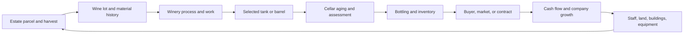

# Winemaker05 UI and Visual Concepts

**Status:** Exploratory concept record. The approved alpha direction is a 2.5D world with Estate, Winery, Cellar, Company, and Management navigation, placeholder scenes/panels, a hideable Activity Manager, and no game data or preference persistence. The intended stack is TypeScript, Vite, and React for the shell, with PixiJS for layered, fixed-composition scenes. Specific layouts, art direction, and any behavior beyond basic navigation and opening/closing placeholders remain proposals. See the [Alpha UI Design Plan](plans/2026-11-13-alpha-ui-design-plan.md).

**Source conversation:** [Winemaker visual and interface brainstorming](https://chatgpt.com/share/6af6f93e-429c-83ed-ad0e-ffa836fb7557). Local generated concept images are embedded below from [`docs/image_inspiration/`](../image_inspiration/).

**Project context:** Winemaker05 now has a placeholder UI prototype; see [application flow](application-flow.md) and [project information](PROJECT_INFO.md) for implemented behavior and tooling. Use the [transition overview](./Winemaker04_to_05_Transition_Overview.md) for the established 05 simulation direction, 04 observations, and open design questions. This document explores how an interface could present that design; it does not redefine the wine model or turn examples from Winemaker04 into Winemaker05 facts.

---

## 1. Why explore a visual interface?

The conversation describes Winemaker as having begun with an ambition similar to *Hundred Days*, but with more detailed wine-production and business simulation. Its panel-based interface is framed as a result of earlier technical constraints as well as the complexity of the simulation. That history is useful context for 05: a visual layer could fulfill the original sense of owning and operating a winery while retaining the depth that makes Winemaker distinct. It is not a request to copy *Hundred Days* or to replace Winemaker's simulation with a simpler game loop.

The proposed direction is a visual winery world supported by detailed panels. The world should make location, ownership, activity, and long-term change visible. Panels, lists, and charts should carry the detailed decisions that are hard to read from a scene: wine development, staffing, costs, production capacity, contracts, forecasts, and company finances.

The visual layer has value when it helps the player see the consequences of decisions. A decorative winery behind the same tables would not by itself justify the work. A scene can contribute when the vineyard changes with the season, a tank represents an occupied vessel, a cellar shows stored lots, or company growth becomes visible over time.

The exchange treats product-making and company-building as two connected parts of the game:

- **Winemaking:** grape variety and maturity, fermentation, extraction, vessel choice, oxidation, and aging should change a wine's character in ways the player can understand and learn from. Decisions should not be reduced to unexplained quality bonuses.
- **Winery business:** a small operation with limited capital, a few employees, a modest winery, and perhaps one vineyard can grow into a larger company with more production capacity, stronger staff, market relationships, and prestigious wines.
- **The connection:** long aging can tie up cash and storage capacity, while a simpler wine that sells sooner can help finance expansion. Production decisions therefore have commercial consequences, and commercial plans can constrain production.

The imagined progression is visible as well as numerical: an operation that begins with a small vineyard, one or a few employees, and a handful of vessels might become a larger winery, impressive cellar, and portfolio of estates across regions and countries. One reply used a twenty-year horizon to illustrate that the world should show the accumulated results of investment. This is a visual progression proposal, not a fixed game length.

## 2. Status and evidence conventions

The source discussion moves between user goals, assistant proposals, generated mockups, and observations about Winemaker04. They should not be conflated:

- **User context:** interest in a fresh iteration with graphical scenes alongside detailed simulation; requests for several scene ideas; and, later, explicit interest in panel-heavy Finance, Contracts, barrel/equipment purchasing, and employee management.
- **Assistant proposals:** scene hierarchy, visual styles, sample panel contents, example interactions, and suggested ways to connect scenes. These remain proposals until approved.
- **04 observations:** the exchange referred to vineyards, lots, equipment, work, staff, sales, and contracts found in or associated with the older project. The [transition overview](./Winemaker04_to_05_Transition_Overview.md) is the repository's fuller account of those findings and of where the old implementation was incomplete. A reference to a 04 mechanic does not make it a 05 requirement.
- **Generated artwork:** the local images are speculative visual references. Their text, values, names, currencies, and interface labels are illustrative, not 05 domain definitions, balance targets, or implemented data.
- **Open 05 work:** exact simulation state, available operations, stored versus derived information, detailed screen layouts, art production, and PixiJS configuration/version remain to be designed.

## 3. Shared interface idea

### 3.1. A world for context, panels for decisions

Winemaker does not have to choose between a graphical game and a deep panel simulation. The suggested combination is a visible winery world with detailed analytical and management panels. This divides work by the kind of information involved:

| System or activity | Suggested presentation |
|---|---|
| Vineyard, growth, harvest | Strong visual scene for season, parcel, work, and estate development; supporting panels for site data, health, maturity, forecasts, and timing choices |
| Winery, tanks, barrels, production | Strong visual scene for vessels, material flow, work, and capacity; panels for selected lot, process, assignments, history, and expected development |
| Buildings and expansion | Visible changes to estate or winery; panels for cost, capacity, prerequisites, and investment consequences |
| Employees and work | Optional lightweight people/activity animation; detailed roster, competencies, teams, assignments, workload, wages, and hiring panels |
| Wine taste, structure, and quality | Analytical panels, profile diagrams, history, and comparisons; do not make structural characteristics a visual minigame |
| Contracts, finance, and markets | Primarily tables, comparisons, timelines, forecasts, and charts; a map or scene can provide context but should not substitute for the decision detail |
| Research and prestige | Detailed panels for projects and progress, with visible consequences in the estate or company where appropriate |

The key is that scenes and panels refer to the same simulation objects. A selected plot, tank, barrel, lot, employee, or contract should be identifiable in both the world and its detail view. Scene interactions may expose or focus a decision, while the panel explains its options, requirements, expected consequences, and uncertainty.

Across the generated layouts, a recurring shell keeps a calendar and main navigation visible while the central scene changes. Many images also suggest weather, cash, staffing, production/storage totals, side panels, and contextual action strips; these remain visual ideas, not required alpha content. The approved alpha shows a calendar and an Advance Time button, while time behavior and alerts are left to implementation planning and excluded from this UI design.

### 3.2. Several linked levels, not one enormous world

The conversation proposes three related levels of detail:

1. **Company level:** portfolio of locations, production, market access, finances, contracts, buyers, company growth, and major projects.
2. **Estate level:** an individual property with vineyards, buildings, staff, agricultural strategy, and harvest activity.
3. **Production level:** a winery and cellar where lots, vessels, processes, work, maturation, and bottling can be inspected.

These can be different scenes in one game and can share one simulation. They do not need separate rendering engines. Nor do they need to be forced into one continuous geographical map. A company that owns vineyards in different regions or countries is better represented as a portfolio of locations, with each estate having its own scene and the company overview linking them. The geographic overview can show distance, market relations, and ownership without pretending that every production activity occurs in one place.

Not every scene needs the same camera. The discussion suggests a broad isometric or elevated landscape for vineyards, a detailed interior for production, a cutaway or shelf-based view for the cellar, and a more abstract map/dashboard for the company. These are art-direction options; consistency can come from shared selection, navigation, typography, and panel conventions rather than one camera style everywhere.

### 3.3. Spatial readability

The conversation began with a general game-UI comparison involving PixiJS-style 2.5D and Three.js-style terrain for another game. The transferable point for Winemaker is about readability: can players understand where locations and objects are, what is connected to what, and how expansion or movement relates to the world? For Winemaker, that can mean clearly reading vineyard parcels, production spaces, storage, and the links between an estate and a wider portfolio. The high-level 2.5D presentation is now approved for Winemaker05; the scene concepts below explore ways to express it.

The original discussion did **not** select PixiJS, Three.js, or any other Winemaker05 technology. The later alpha decision selects PixiJS for layered, fixed-composition scenes, with React/HTML/CSS for shell panels and controls. The images are design illustrations, not renderings from an engine; the current prototype's version and modules are recorded in [project information](PROJECT_INFO.md).

## 4. Scene and panel proposals

The concepts below collect the scene ideas and the panel-heavy follow-up into one working set. They can be combined or narrowed later.

### 4.1. Estate and vineyard

**Scene role:** give the player a sense of place, season, land, scale, and visible agricultural work. Show parcels, paths, winery buildings, storage, workers or machinery where useful, and development as the operation expands.

**Possible parcel interaction:** select a vineyard parcel and show its variety and site identity alongside the information needed for a harvest decision. The source examples include soil, aspect/exposure, altitude, planting density, vine age, health, ripeness, and expected yield. A seasonal view could help the player decide whether to harvest now or wait, with current conditions and the forecast shown in a side panel. These are example categories from the conversation, not a locked 05 schema.

**Possible visual cues:** distinct parcels, selected-area outline, variety markers, seasonal color, work crews or harvest activity, and an active-production list linking harvested material to lots in the winery. Keep precise forecasts and historical comparisons in a panel or chart.

**Geographic scope:** treat each property as its own place. The company map can connect estates in different regions and countries, but the estate scene should not imply that distant vineyards share one continuous land parcel or local winery.

### 4.2. Winery and production floor

**Scene role:** make production flow, occupied space, and capacity understandable. Tanks, presses, barrels, bottling equipment, and work areas can be visible objects, with activity tied to whichever production model 05 adopts.

**Possible tank selection:** selecting a concrete tank could open a panel for its current contents, lot origin, capacity and fill, process or fermentation method, temperature or other relevant conditions, assigned staff, scheduled work, progress, history, cleanliness/readiness, and expected development. A lot-first selection could highlight every vessel or work area currently associated with that lot.

**Operational continuity:** the conversation proposes showing harvested grapes arriving from an identified parcel, moving through winery operations, occupying vessels, entering the cellar or bottling, and eventually becoming inventory associated with sales. This continuity makes the visual environment meaningful, provided the underlying lot and material model supports it.

**Capacity and readiness:** one example is a filled tank being unavailable for another lot; after emptying, it may still need cleaning before reuse. This is a useful candidate for a clear, tangible capacity/readiness interaction. It is not a statement that 05 has adopted this exact availability or cleaning lifecycle.

**Panel emphasis:** detailed queues and work assignment should remain available without requiring the player to find and click every object in a large room. A production list can jump to or highlight an object, and object selection can open the same authoritative lot/process details as the list.

### 4.3. Cellar and wine development

**Scene role:** make stored wine, available capacity, and time in storage visible. The concepts include barrel rows and bottle storage, with individual lots or vessels selectable. A side-cut cellar is one possible way to make containers easy to read and select.

**Possible lot panel:** show the wine's current profile, selected historical snapshots, development over time, vessel and storage information, expected future development, and available next actions. Charts could compare characteristics, taste, or evaluation through time. A forecast should be presented as a projection, with its assumptions and uncertainty made clear once those are designed.

**Decision focus:** the cellar could help answer whether to continue aging, move or change a lot's storage, bottle it, hold it, or release it to the market. That decision combines product goals with storage limits and cash tied up in unsold inventory. The transition overview already describes the cellar as a central 05 management priority; exact cellar operations and forecasts are still open.

**04 caveat:** the source conversation noted that some aging and oxidation behavior existed in 04 while the more complete effects of individual storage vessels were unfinished or deferred. Treat that as historical context only. For 05, vessel-to-wine effects and pre-/post-bottle development need to follow the decisions in the [transition overview](./Winemaker04_to_05_Transition_Overview.md), rather than be inferred from these illustrations.

### 4.4. Company overview and estate portfolio

**Scene role:** provide a dashboard-like overview of the company, geographically separated estates, market connections, and business growth. A regional or world map can be one module; charts and panels should carry precise financial and operational data. The alpha direction favors a dashboard over a map-first page.

**Possible overview elements:** estate cards, ownership and production summaries, market access or buyer relationships, company prestige or reputation indicators, key financial totals, active contracts, major work, company growth, and milestones. Selecting an estate could open its own scene instead of drilling into a single giant world.

The generated concepts use Europe and additional global locations to communicate a portfolio spread across countries. These named places are artwork examples, not required Winemaker settings or a geography decision.

For the alpha, high-score/achievement sections and statue or landmark imagery may inspire empty dashboard modules. These are presentation references to Winemaker04 and do not adopt its scoring, award, or progression rules.

### Wine detail modal

Focused wine details may use Winemaker04 modal patterns for visual hierarchy and interaction. Adapt their content to Winemaker05's evolving wine and cellar concepts; the alpha only needs a navigable placeholder modal with working open/close behavior.

### 4.5. Finance dashboard

The user's follow-up explicitly asked for panel-heavy Finance ideas. The suggested design is a decision dashboard with recent actuals, current position, and projections, rather than a single cash number. Candidate modules include:

- liquidity and cash available;
- revenue and operating costs, with operating result or margin;
- cash-flow history and a near-term forecast;
- assets, liabilities, debt, loans, repayments, and payment dates;
- spending and investment commitments, including production, storage, and equipment;
- company growth over time, such as revenue, capacity, locations, or prestige;
- potential owner/founder return or buyout information if that becomes part of the 05 business model.

Finance should connect to concrete winery choices. A panel might explain how committing funds to a long aging period, purchasing new equipment, accepting a delivery contract, or expanding an estate affects liquidity and future capacity. The examples are screen concepts only; the conversation does not settle accounting categories, formulas, financing rules, or the existence of buyout mechanics.

### 4.6. Sales, market, and contracts

The conversation suggests that buyers, suppliers, regions, market relationships, and contracts can be represented through an abstract map plus detailed panels. Contract management is principally a panel/table workflow, not a spatial minigame.

Candidate views include a list of offers and active agreements; buyer or market details; terms and deadlines; production or stock committed to delivery; progress and risk; expected revenue and payment timing; and a history of the relationship. A contract detail could link to wines that meet its intended profile and to inventory that is available or aging. Eligibility, price, quantity, penalties, and buyer behavior must be derived from the eventual 05 commercial design; these are not fixed fields here.

An important design opportunity is to make the trade-offs legible: accepting a contract may offer predictable income, while holding a lot for further development may produce a different product and possible future value. The exact mechanics and how much uncertainty to show remain open.

### 4.7. Barrel and equipment purchasing

The equipment marketplace mockup directly answers the request for barrel/equipment acquisition ideas. It uses a full-screen purchasing panel with a winery image alongside a structured marketplace.

Candidate functions shown or suggested by the mockup:

- browse categories such as barrels, tanks, equipment, cleaning, and history;
- filter used/new items and sort listings;
- compare offers from local suppliers and global listings;
- inspect a selected item with type, capacity, material, age, condition, cleanliness, fill level, ownership/service history, and estimated value;
- compare equipment classes and their capacity, material, cost, expected life, maintenance, and any process-relevant characteristics;
- review current inventory and utilization, planned acquisitions, storage capacity, and projected capacity after purchase;
- see a purchase summary separating price, transport, relationship discount or other terms, and recurring maintenance;
- add a selected item to a purchase plan or complete a purchase.

The main design value is comparative decision support: the cheapest vessel may not fit the desired capacity, maintenance budget, production plan, or intended wine development. The interface should expose relevant trade-offs once 05 establishes which equipment attributes actually affect simulation outcomes. Mockup values, seller names, item availability, discounts, warranties, and terminology are illustrative only.

### 4.8. Employees, teams, and workload

The staff mockup is another panel-heavy management scene. It makes the roster and team operations primary and uses small character portraits or background workers as visual texture rather than requiring animated individuals for every decision.

Candidate modules include:

- a searchable and filterable employee roster by role, team, or current assignment;
- employee details such as current work, experience, strengths or competencies, morale, loyalty, and relevant role-specific qualifications;
- team composition and areas of responsibility;
- active task assignment, deadlines, progress, and staffing;
- workload and multitasking indicators to make over-allocation visible;
- wage totals and staffing costs;
- recruiting candidates with experience, skills, and expected compensation;
- employee development or specialization, if included in the eventual design;
- productivity or morale trends over time.

The interface should help answer: who can do this work, what are they doing now, what happens if I reassign them, and is the team overloaded? The source image illustrates competencies, teams, work assignment, recruitment, and workload. Its exact competencies, ratings, formulas, bonuses, morale model, and salary figures must not be copied as 05 rules.

### 4.9. Research, reputation, and company growth

The conversation places research and prestige mostly in panels, with any earned progress reflected visually in the world. Example forms include a research/project list, progress and cost, future capability, and a visible change to the estate, winery, cellar, or company overview when a project or investment takes effect.

This can complement long-term company growth without making every intangible system into a physical scene. The specific research, reputation, progression, and unlock mechanics remain undecided.

## 5. How views can stay connected

A useful interaction pattern is to make selection and navigation consistent across scenes and panels:

1. Select an object in a scene or list.
2. Show its identity and current simulation facts in a detail panel.
3. Offer the relevant decisions, with costs, constraints, timing, and likely consequences.
4. After the simulation advances or an action completes, update both the scene and panel from the same authoritative state.
5. Keep history and comparison views available for decisions that depend on development over time.

The conversation's physical-continuity example can be represented as:

This diagram describes a possible presentation of the connected simulation, not a 05 state machine or a claim that every transition is already designed. The authoritative lot model, physical transformations, lifecycle, commercial flow, and central cellar workflow are addressed by the transition overview.

## 6. Visual references

All included files are from [`docs/image_inspiration/`](../image_inspiration/). Treat generated text and interface content as noisy visual mockup material: images help communicate layout, scene scale, object emphasis, and panel density, but do not define values or rules.

### Estate scenes and combined overviews

#### Seasonal estate overview

Wide vineyard landscape, selected parcel, right-side parcel details, season and weather, ripeness/yield presentation, bottom action strip, and an active-production list.

#### Estate overview with multiple panel types

Central estate scene with selected parcel details, production and upcoming work, a wine detail panel, and a small estate map. Useful for considering how much information can sit beside a strong visual scene.

#### Vineyard-to-company portfolio board

Four linked views: vineyard parcel selection, winery tank/process, cellar lot detail, and a company portfolio map. The scene variety and navigation continuity are the main references.

#### Estate, production, cellar, and corporate views

Four scene concepts emphasizing parcel details and harvest timing, selected production equipment, cellar management, and company-level properties and finances.

#### Vineyard, cellar, and strategy board

Four scenes with parcel work, an active fermentation tank and production queue, a detailed cellar wine profile, and a multi-location company overview with tasks and business information.

#### Four-overview layout study

Parcel details and weekly work, a tank panel with batch/process/log/maintenance tabs, cellar characteristics and aging history, and a company overview with finance, contracts, staff, and current tasks.

### Panel-heavy business scenes

#### Equipment and vessel marketplace

Marketplace listings, a selected vessel profile, category comparisons, supplier options, inventory utilization, capacity forecasting, and a purchase-cost summary. This is the reference for equipment acquisition and barrel/tank decisions.

#### Personnel and team management

Roster and employee detail, team overview, task assignment, payroll, hiring candidates, competencies, productivity, and workload. This is the reference for employee control and staff-management panels.

## 7. Remaining questions for future implementation

These concepts are intended to make later decisions concrete. They do not answer them:

- Which lots, vessels, facilities, staff, contracts, and investments are actual authoritative 05 objects, and which facts are derived summaries?
- What exact information belongs in each placeholder scene, panel, and modal after the simulation data model is defined?
- Which transitions deserve animation, and which are better expressed with a status change or short event log?
- How should the company overview represent geographically separated estates, buyers, and markets without implying a single contiguous property?
- Which wine profile charts explain player decisions best, given the open evaluation and sensory design in the transition overview?
- Which storage and equipment attributes have real effects in the 05 simulation, and how should uncertainty in long-term forecasts be shown?
- What Finance and Contracts data, accounting rules, and financing mechanics belong in 05?
- How much detail should employee competencies, teams, task assignment, morale, recruitment, and development receive?
- What visual changes should communicate company progress over many years without relying on fixed asset-count or prestige targets?
- What exact scene composition and camera framing best express the approved scene-specific 2.5D direction for each location, and what prototype should validate readability?
- Which future renderer configuration best supports those interactions, accessibility, and panel integration?

Calendar behavior and alert handling are outside this UI design and will be resolved by implementation agents. Later work can refine the prototype's shell, scenes, panels, and company dashboard before committing to detailed art or simulation behavior.
